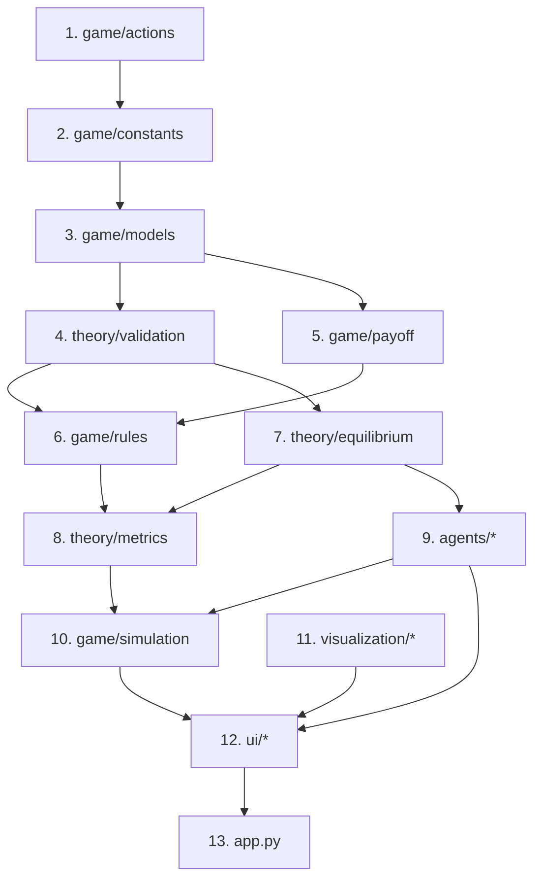
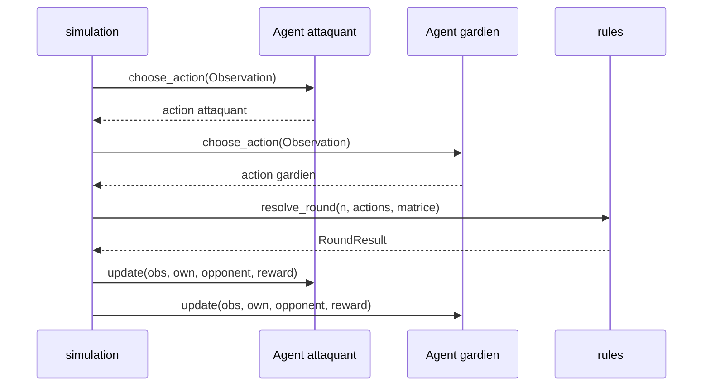
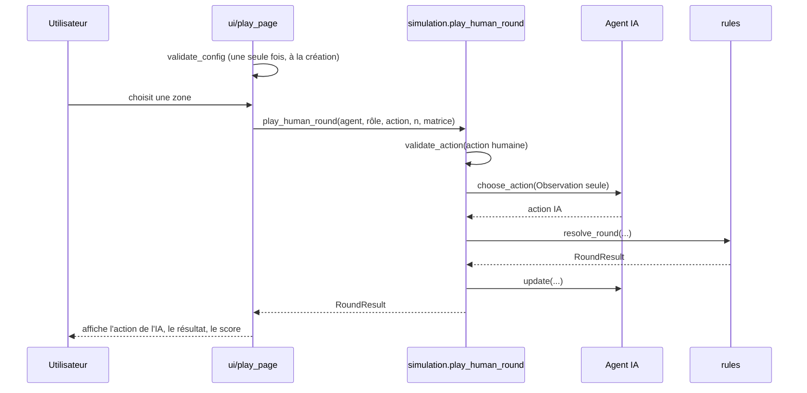
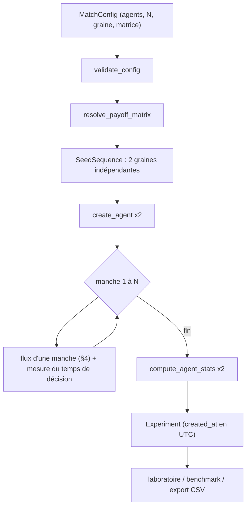
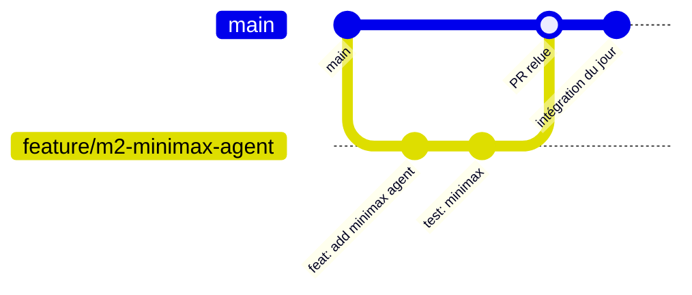

# Architecture — Penalty Shootout AI Arena

| Version | Date       | Statut                                          |
|---------|------------|-------------------------------------------------|
| 1.0.0   | 2026-11-09 | Aligné sur `api_contract.md` v1.1.0             |

Ce document explique **comment le projet est construit** et **comment les
pièces communiquent**. Il s'adresse à toute l'équipe : lisez-le avant d'écrire
du code. Les signatures exactes sont dans `docs/api_contract.md`, les
mathématiques dans `docs/game_theory.md`. En cas de désaccord, le contrat
d'API fait foi.

---

## 1. Vision générale

L'application modélise un duel de tirs au but comme un **jeu matriciel à somme
nulle** : l'attaquant et le gardien choisissent *en même temps* une zone
(gauche, centre, droite). Une matrice `A` donne le gain de l'attaquant ; celui
du gardien est `-A`.

Trois usages reposent sur le même moteur :

| Usage            | Description                                  | Produit                     |
|------------------|----------------------------------------------|-----------------------------|
| Humain contre IA | L'utilisateur joue un rôle contre un agent   | liste de `RoundResult`      |
| IA contre IA     | Deux agents jouent N manches automatiquement | un `Experiment`             |
| Laboratoire      | Comparaison, métriques, graphiques           | tableaux et figures Plotly  |

### Trois idées à retenir

1. **Un seul endroit par responsabilité.** La meilleure réponse, la
   validation, la matrice effective et les métriques existent une seule fois.
   On les *appelle*, on ne les recopie jamais.
2. **Les dépendances vont dans un seul sens** (voir §3). Le moteur ne connaît
   ni l'interface ni les agents ; l'interface ne calcule rien.
3. **Un agent ne peut pas tricher.** Il ne reçoit jamais l'action courante de
   l'adversaire, et cette garantie vient de la *structure des données*, pas de
   la bonne volonté des développeurs (voir §7).

---

## 2. Architecture des dossiers

```text
penalty_shootout_ai/
├── app.py                      # point d'entrée Streamlit (M3)
├── requirements.txt
├── README.md
├── docs/                       # documentation (architecture, contrat, théorie)
├── game/                       # moteur du jeu (M1)
│   ├── actions.py              #   enum Action
│   ├── constants.py            #   constantes, tolérances, valeurs par défaut
│   ├── models.py               #   dataclasses partagées
│   ├── payoff.py               #   matrice et lecture des gains
│   ├── rules.py                #   validation, résolution d'une manche, score
│   └── simulation.py           #   orchestration des matchs
├── theory/                     # mathématiques (M1)
│   ├── validation.py           #   validité des stratégies et matrices
│   ├── equilibrium.py          #   minimax (linprog), meilleure réponse
│   └── metrics.py              #   indicateurs et AgentStats
├── agents/                     # intelligences artificielles (M2)
│   ├── base_agent.py           #   classe abstraite BaseAgent
│   ├── deterministic_agent.py
│   ├── frequency_agent.py
│   ├── minimax_agent.py
│   ├── fictitious_play_agent.py
│   └── __init__.py             #   fabrique create_agent
├── visualization/              # figures Plotly (M4)
├── ui/                         # pages Streamlit (M3)
├── data/                       # experiments/, exports/, samples/
├── tests/                      # tests pytest (chacun teste son module)
└── notebooks/                  # expérimentations
```

| Dossier          | Rôle en une phrase                                         | Peut importer                    |
|------------------|------------------------------------------------------------|----------------------------------|
| `game/`          | Règles et orchestration, sans connaître l'interface        | `theory/`, `agents/` (simulation seulement) |
| `theory/`        | Calculs mathématiques purs                                 | `game/` (couches basses)         |
| `agents/`        | Décider une action à partir d'informations autorisées      | `game/` (modèles), `theory/`     |
| `visualization/` | Transformer des résultats en figures                       | modèles et résultats             |
| `ui/`            | Saisir, afficher, appeler le moteur                        | tout ce qui est en dessous       |

> Note : `game/actions.py`, `constants.py` et `models.py` figurent dans
> `docs/project_structure.md` mais pas dans le schéma du cahier des charges.
> `project_structure.md` est la référence ; pensez aussi à y ajouter
> `tests/test_validation.py`.

---

## 3. Diagramme des dépendances

Règle : **un module n'importe que des modules des couches situées au-dessus de
lui.** Cela interdit les imports circulaires et garde le moteur testable seul.



Version texte, dans l'ordre des couches :

```text
 1. game/actions.py
 2. game/constants.py       <- actions
 3. game/models.py          <- actions, constants
 4. theory/validation.py    <- constants, models
 5. game/payoff.py          <- actions, constants, models
 6. game/rules.py           <- actions, models, payoff, theory.validation
 7. theory/equilibrium.py   <- actions, constants, models, theory.validation
 8. theory/metrics.py       <- actions, models, game.rules, theory.equilibrium,
                               theory.validation
 9. agents/*                <- actions, constants, models, theory.equilibrium,
                               theory.validation
10. game/simulation.py      <- agents, game.*, theory.metrics
11. visualization/*         <- modèles et résultats
12. ui/*                    <- simulation, agents, visualization
13. app.py
```

### Interdits à connaître

- `theory/validation.py` n'importe **ni** `game.rules`, **ni** `game.payoff`,
  **ni** un agent.
- `agents/*` n'importent **ni** `game.simulation`, **ni** `ui`,
  **ni** `visualization`, **ni** `streamlit`.
- `ui/*` et `visualization/*` **ne calculent rien** : ils affichent ce que le
  moteur et `theory/` ont calculé.

---

## 4. Flux d'une manche

Une manche suit toujours le même ordre. **L'ordre est une exigence de
sécurité** (voir §7).



Étapes :

1. **Décision** : chaque joueur choisit sans voir l'autre.
2. **Validation** : `validate_action` accepte une `Action` ou un indice 0, 1, 2
   et rejette tout le reste (y compris `True` et `False`).
3. **Résolution** : `resolve_round` lit la matrice et fabrique le
   `RoundResult`. C'est le **seul endroit** où un `RoundResult` est créé.
4. **Révélation et apprentissage** : les deux agents reçoivent les deux actions
   via `update`, jamais avant.

Gain du gardien = `-gain de l'attaquant`, par construction (une seule matrice
est stockée).

---

## 5. Flux humain contre IA



Points d'attention :

- Un joueur humain correspond à un agent égal à `None` dans `MatchConfig`.
  Deux `None` sont interdits (pas de mode humain contre humain).
- L'interface **n'affiche l'action de l'IA qu'après** la validation du choix
  humain.
- La matrice est validée **à la création** de la partie, pas à chaque manche.
- Le résultat est un historique de `RoundResult` (fonction F08). Il ne produit
  **pas** d'`Experiment`.

---

## 6. Flux IA contre IA



Reproductibilité :

- Même graine et mêmes paramètres → mêmes `Experiment.rounds`.
- `created_at` est la seule donnée non reproductible : dans les tests, on
  compare `rounds`, pas l'objet entier.
- Un benchmark répète l'expérience avec les graines `DEFAULT_SEED + k`, le même
  nombre de manches et les mêmes adversaires pour tous les agents.

> **État (contrat v1.1.0)** : `game/simulation.py` dépend de `agents/`, pas
> encore livré. Tant que M2 n'a pas livré, ses tests attendent. Les autres
> modules de `game/` et `theory/` sont testables dès maintenant.

---

## 7. Sécurité contre les fuites d'information

**Principe : un agent ne connaît jamais l'action courante de l'adversaire avant
de décider.**

| Mécanisme | Comment il protège |
|-----------|--------------------|
| Entrée restreinte | `choose_action` reçoit une `Observation` (`role`, `round_number`) qui n'a **aucun champ** pour l'action adverse |
| Historique par `update` | L'agent apprend les actions adverses seulement après révélation et construit lui-même ses compteurs |
| Ordre imposé | `simulation` : `choose_action` des deux, validation, `resolve_round`, puis `update` des deux |
| Isolation | Aucune référence vers l'adversaire, la simulation, la configuration ou l'interface |
| Pas d'état partagé | Pas de variable de module mutable ; un `numpy.random.Generator` par agent |
| Immutabilité | `Observation` et `RoundResult` sont `frozen=True` |
| Imports interdits | `agents/` n'importe ni simulation, ni UI, ni visualization, ni streamlit |

**Information publique autorisée** : la matrice des gains (donnée au
constructeur), son propre rôle, le numéro de manche et les manches terminées.

**Tests obligatoires** (`test_agents.py`, `test_simulation.py`) :

- même graine et même historique → même action, quelle que soit la future
  action adverse ;
- `update` n'est appelé qu'après résolution ;
- `reset` restaure l'état initial *et* la séquence aléatoire ;
- `choose_action` n'accepte qu'une `Observation`.

Minimax tire son action selon sa stratégie mixte : c'est l'exécution d'une
stratégie calculée, pas un agent aléatoire.

---

## 8. Rôle de chaque membre

| Membre | Responsabilité | Fichiers | Livrables |
|--------|----------------|----------|-----------|
| **M1** Moteur et théorie (intégration) | Règles, matrice, équilibre, métriques, simulation, intégration | `game/*`, `theory/*` | Moteur testé, contrat d'API, validation des PR `contract` |
| **M2** Agents IA | Quatre agents, `BaseAgent`, `create_agent` | `agents/*` | Agents testés, anti-fuite vérifié, documentation des politiques |
| **M3** Interface et jeu | Navigation, humain contre IA, IA contre IA, score, historique | `app.py`, `ui/*` | Application jouable, guide de prise en main |
| **M4** Visualisation et qualité | Graphiques, laboratoire, benchmark, export CSV | `visualization/*`, métriques de benchmark | Benchmark, protocole de test |

Interfaces entre membres :

| De | Vers | Fournit |
|----|------|---------|
| M1 | M2 | `Action`, `Observation`, matrice, `best_response`, `solve_equilibrium`, `Equilibrium.strategy_of` |
| M2 | M3 | `BaseAgent` et `create_agent` stables |
| M1, M2 | M4 | `RoundResult`, `AgentStats`, `Experiment`, fonctions de `theory/metrics.py` |
| M3 et M4 | — | Composants communs du laboratoire et du benchmark |

Règle d'or : **on ne modifie pas le module d'un autre sans l'accord de son
propriétaire.** Chacun teste son propre module.

---

## 9. Cycle d'intégration Git



1. **Une branche par fonctionnalité** : `feature/<membre>-<sujet>`
   (exemple : `feature/m2-minimax-agent`).
2. **Commits** au format `type: description` (`feat`, `fix`, `test`, `docs`,
   `refactor`).
3. **Pull Request** vers `main`, avec **au moins une relecture** d'un autre
   membre.
4. **Définition de « terminé »** : la fonctionnalité fonctionne dans
   l'application intégrée, a au moins un test, respecte les règles du jeu et
   passe `mypy --strict`.
5. **Intégration quotidienne** ou à chaque jalon, avec démonstration. M1
   résout les conflits.
6. **Changer le contrat** (`models.py`, `constants.py`, `actions.py` ou une
   signature) : PR avec le label `contract`, mise à jour de
   `docs/api_contract.md` dans la même PR, approbation de M1 et des membres
   impactés. Les signatures sont **gelées après le jour 2**.
7. **Décisions techniques** : à consigner dans `docs/meeting_notes.md`.

Vérifications avant une PR :

```bash
python -m pytest
python -m mypy --strict .
```

La configuration pytest minimale à la racine :

```ini
[pytest]
pythonpath = .
testpaths = tests
```

---

## 10. Extensions futures

Hors du périmètre actuel, à ne lancer qu'une fois le noyau stable.

| Extension | Impact sur l'architecture |
|-----------|---------------------------|
| **Matrice réaliste** `A[i][j] = 2p(i,j) - 1` | Casse l'hypothèse ±1. Il faut repenser `RoundResult.is_goal`, `compute_score` et les taux de buts/arrêts. Piste : stocker l'issue (but ou arrêt) dans `RoundResult`. D'ici là, **ne pas fournir de matrice dont les gains diffèrent de ±1** |
| **Variante séquentielle** (feinte, puissance puis direction) | Seul cas où un arbre de décision (NetworkX) devient utile ; nouveau module, sans toucher au modèle simultané |
| **Export CSV et SQLite** | Écriture dans `data/exports/` et `data/experiments/` depuis une couche dédiée, sans logique métier |
| **Nouveaux agents** | Un fichier dans `agents/`, un membre de `AgentType`, une branche dans `create_agent` |
| **Mesure de prévisibilité séquentielle** | L'exploitabilité ne la voit pas (une séquence G, C, D répétée a une exploitabilité nulle) ; ajouter une métrique dans `theory/metrics.py` |

Hors périmètre définitif (cahier des charges) : humain contre humain, agent
aléatoire autonome, Q-learning et apprentissage profond, animation 3D,
multijoueur réseau.